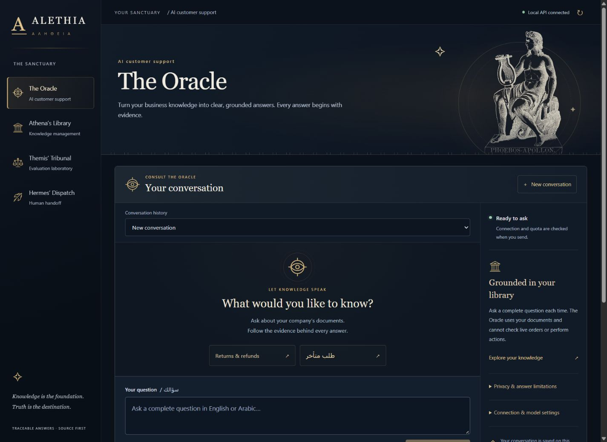

# ALETHIA · ΑΛΗΘΕΙΑ

**Where Knowledge Becomes Answers.**

**Public guided showcase:** [alethia-three.vercel.app](https://alethia-three.vercel.app) — saved fictional examples, source inspection, illustrative handoff, and actual provisional retrieval results. The complete RAG application continues to run locally.

A multilingual RAG customer support platform with a Greek mythology visual identity. Document storage, embeddings, retrieval, and conversations run locally. Answer generation now defaults to Google Gemini to reduce RAM use; an explicit Ollama mode remains available. Designed for fictional e-commerce data and reproducible evaluation.

## Current milestone

The **guided demo — saved examples** showcase is public. It includes four English/Arabic saved examples, working evidence links, illustrative handoff and actual provisional retrieval results. The owner confirmed interactive verification; anonymous HTTP, asset hashes and the deployed connection-blocking policy were checked. See [release evidence](docs/portfolio-release.md), [actual pilot results](docs/pilot-summary.md) and [source release notes](docs/github-release.md).



*Historical screenshot of the full local application using fictional data; the public showcase is explicitly labelled saved playback.*

| Workspace | Implemented capability |
| --- | --- |
| The Oracle | English/Arabic answer drafts with source quotes and conservative handoff |
| Athena's Library | PDF/DOCX/TXT/Markdown ingestion, source inspection, BM25/dense/hybrid retrieval |
| Themis' Tribunal | Review workflow, reproducible retrieval experiments and real pilot aggregates |
| Hermes' Dispatch | Local support tickets, status history and internal notes |

**Phase 6 is complete for the implemented application:** all four workspaces are polished, module-specific Greek artwork and scroll motion are included, and desktop/mobile checks and the production build pass. Library has filename filters/sorting and expandable index tools; Dispatch has ticket search; Themis has searchable, incremental report traces. See [delivery verification](docs/phase-6.md), [portfolio case study](docs/portfolio-case-study.md), [demo walkthrough](docs/demo-walkthrough.md), and [screenshots](docs/screenshots/README.md).

**The overall MVP is not yet complete.** Human-reviewed retrieval and generation evaluation remains unfinished. UI polish and passing tests do not establish answer accuracy.

The owner's full local pack has **150 agent-authored candidates**: 120 development and 30 private reserved test questions across 50 trilingual intent groups. The public source includes only the **120 development candidates**; a fresh clone has no held-out questions or review attestations. See [benchmark boundaries](data/benchmarks/README.md). Human review is underway locally. Relevance-grade editing, cross-language label-review prompts, pack fingerprints, filters, exports, and evidence preflight support that work. Quality scoring requires eligible reviewed cases and an actual experiment. Final review/freeze, reranking comparisons, and generation/handoff evaluation remain unfinished.

## Run the guided showcase without a backend

```powershell
cd frontend
npm.cmd ci
npm.cmd run build:portfolio
npm.cmd run preview:portfolio
```

Open **http://127.0.0.1:4174**. This read-only mode needs no API key, Python backend or model download. `VITE_APP_MODE` defaults to `local`; the explicit portfolio build selects a separate bundled-data entry with no generation requests.

## Run locally on Windows

Prerequisites: Python 3.11 with SQLite FTS5 support and Node.js 22.12+ (Node 24 was detected). Initial dependency/model installation needs internet. Gemini generation requires internet and a backend API key. Ollama and a GPU are not required for Gemini mode; dense retrieval still requires the optional local encoder and at least 1 GiB available RAM.

From the project root, create an isolated backend environment:

```powershell
python -m venv .venv
.\.venv\Scripts\python.exe -m pip install -r backend\requirements-lock.txt
.\.venv\Scripts\python.exe -m uvicorn app.main:app --app-dir backend --host 127.0.0.1 --port 8000
```

In another terminal:

```powershell
cd frontend
npm.cmd ci
npm.cmd run dev
```

Open **http://127.0.0.1:5173**. The frontend forwards `/api` to FastAPI on port 8000. API docs: **http://127.0.0.1:8000/docs**. Both servers bind to loopback. Stop either server with Ctrl+C in its terminal. The frontend reports API unavailability if the backend is stopped.

Configuration: the backend reads `ALETHIA_LLM_PROVIDER`, `GEMINI_MODEL`, and `GEMINI_API_KEY` from the ignored project `.env` or exported environment variables (environment wins). Restart the API after changing them. The API key is never a `VITE_` variable and never belongs in frontend source. Vite separately reads `ALETHIA_API_TARGET`; restart Vite after changing its proxy target. Optional Ollama settings still use exported environment variables.

### Optional local semantic search

Install the pinned CPU runtime and explicitly download the pinned public model files once:

```powershell
.\.venv\Scripts\python.exe -m pip install -r backend\requirements-ml-lock.txt
.\.venv\Scripts\python.exe scripts\prepare_embedding_model.py
```

Restart the API, open Athena’s Library, load documents, and choose **Build encoder index**. Then select **Semantic · E5 / FAISS (same chunks)**. The INT8 multilingual E5-small artifacts occupy about 130 MiB; downloads are verified against pinned hashes. Inference is offline and runs in short-lived CPU workers, with a 768 MiB worker limit and at least 1 GiB available system RAM required to start. A live build on this machine peaked at about 514 MiB resident RAM. Optional dependencies are isolated from API startup; the base installation retains document management and original BM25.

Changing documents makes the encoder snapshot stale. Rebuild it explicitly before using either encoder retrieval mode. See [Phase 2d](docs/phase-2d.md) for resource limits, reproducibility, model provenance, and quality limitations.

### The Oracle: Gemini generation (default)

Set these in the project’s ignored `.env`, using a replacement key created privately in Google AI Studio:

```dotenv
ALETHIA_LLM_PROVIDER=gemini
GEMINI_MODEL=gemini-3.1-flash-lite
GEMINI_API_KEY=your_replacement_key_here
```

Restart the API, refresh Oracle readiness, then ask a complete question. A configured key does not imply verified permissions/quota. The integration uses a fixed HTTPS endpoint, a 1,024-token output cap, and no tools, automatic retries, or provider/model fallback. Provider errors are sanitized. No key from chat is included in the repository or local configuration.

Google currently lists this model with a [free tier](https://ai.google.dev/gemini-api/docs/pricing). Use a project without paid billing to preserve the zero-cost constraint: the application cannot determine billing status or force a billed project to use free quota. Free-tier submissions can be used to improve Google products. Questions and selected passages are sent to Google; use the fictional demo pack. Raw uploaded files and prior conversation turns are not uploaded by this adapter.

Saved conversations survive browser/API restarts in ignored `data/local/alethia-conversations.sqlite3`: at most 100 conversations, 30 turns each. Source links are rechecked when loading a conversation; changed/deleted citations are labelled and disabled. Historical answer/quote snapshots remain until the conversation is deleted. Each question remains independent; recognizable ambiguous follow-ups ask for clarification rather than guessing. See [Phase 3b](docs/phase-3b.md).

### Hermes’ Dispatch: local human handoff

Open a saved Oracle turn and choose **Create local support ticket**. This is an explicit action; abstention alone creates no ticket. Repeated creation opens the same ticket. Choose **Open local support ticket** to review it in Dispatch, filter by status, add internal notes, and move between **Open**, **In progress**, and **Resolved**. Resolving requires a note; reopening keeps previous activity. Concurrent edits are protected by revision checks.

Tickets persist in ignored `data/local/alethia-tickets.sqlite3` with up to 500 tickets / 50 events each. Tickets retain their question/evidence snapshot even if the original conversation or document is deleted. Source freshness is checked on ticket load; delete the ticket separately to remove its saved copy. Deletion requires confirmation and is not secure erasure. No email, notification, or customer message is sent. See [Phase 4a](docs/phase-4a.md).

### Optional: local generation on Windows/NVIDIA

This is an explicit alternative, never an automatic fallback. Export `ALETHIA_LLM_PROVIDER=ollama` before starting the API to select it. The following older local setup is unnecessary for Gemini mode.

Prepare the encoder index first. Explicit setup downloads a pinned official Windows Ollama archive (~1.59 GB compressed, ~2.23 GB extracted), followed by the Qwen 1.5B Q4 model (~986 MB). Allow at least 8 GiB free disk space before setup. Files remain in ignored `models/`; no global PATH or startup entry is installed.

```powershell
.\.venv\Scripts\python.exe scripts\prepare_ollama_runtime.py
.\scripts\start_ollama.ps1
```

Keep that terminal running. In another terminal, pull/verify the model once:

```powershell
.\.venv\Scripts\python.exe scripts\prepare_qwen_model.py
```

With API and frontend running, open **The Oracle**, choose **Refresh readiness**, and ask a complete question. Try `How many days after delivery can I request a change-of-mind return?` or `ما هي مدة الإرجاع بسبب تغيير الرأي؟`. Inspect each quote and click its source link. A `needs_human` result does not create a ticket or send a message.

The start script disables Ollama cloud inference, binds loopback, and limits parallel/model loading. The measured candidate uses a 4,096-token context, 384-token output cap, temperature 0, and unloads after requests. Admission requires at least 1 GiB free system RAM and 1.5 GiB free NVIDIA VRAM. RAM can fall below the admission threshold while loading; it is not reserved memory. The external Ollama runner is not covered by the embedding worker’s 768 MiB allocation cap. See [Phase 3a](docs/phase-3a.md) for observed failures, resource measurements, and remaining work.

## Verify

```powershell
$env:PYTEST_DISABLE_PLUGIN_AUTOLOAD = '1'
.\.venv\Scripts\python.exe -m pytest -c backend\pytest.ini -q
cd frontend
npm.cmd run build
```

`npm run build` performs strict TypeScript checking and creates `frontend/dist`. For a local demo of that built bundle, keep the API running, then run `npm.cmd run preview` from `frontend` and open **http://127.0.0.1:4173**. The preview binds to loopback and proxies `/api` to the same configured backend target. This is a local demo server, not a public deployment.

From the project root, `.\scripts\verify.ps1` runs the dependency check, backend tests, both frontend builds, public-bundle audit and rendered guided-route checks in sequence and stops on failure. It installs nothing and makes no Gemini requests. Optional-ML tests can skip when those dependencies are absent; inspect the test summary. The prepared GitHub Actions workflow also checks publication boundaries; its remote execution awaits an approved push.

`backend/requirements-lock.txt` records the tested Python 3.11 base dependency set; `requirements-ml-lock.txt` adds the optional ML runtime. See the [release verification record](docs/github-release.md) for current checks. One upstream Starlette/AnyIO deprecation warning remains. ML-specific tests skip without optional dependencies. Tests cover ingestion/retrieval, context/citation contracts, saved-history concurrency/retention, mocked Gemini handling, tickets, metric formulas, review invalidation, split boundaries for seeds/edits, preflight, pack fingerprints, graded drafts, and evaluation corpus-change rejection. Synthetic test fixtures are engineering checks, not quality measurements. Broader generation quality and real quota-failure behavior remain unverified.

## Architecture

- `frontend/src`: React + TypeScript, Vite, Tailwind CSS, custom CSS, local SVG icons and credited public-domain engravings. No external fonts or runtime image services.
- `backend/app`: FastAPI + Pydantic, bounded document ingestion, SQLite document store, isolated PDF/DOCX parsers, and a separate BM25 retrieval module. No models imported at API startup.
- `backend/tests`: input limits, source references, duplicate/concurrent uploads, replacement/deletion, persistence/rollback, schema migration, malformed files, and real parser resource limits.
- `data/demo/ecommerce`: original fictional English/Arabic business policies.
- `docs/phase-1.md`: environment findings, acceptance criteria, model candidates, and risks.
- `docs/phase-2a.md`: document API, storage behavior, acceptance checks, and limitations.
- `docs/phase-2b.md`: PDF/DOCX extraction, resource budgets, provenance, migration, and limitations.
- `docs/phase-2c.md`: persistent BM25 index, query API, normalization, source links, validation, and known limitations.
- `docs/phase-2d.md`: pinned local encoder, FAISS snapshots, shared chunk corpus, resource checks, and functional validation.
- `docs/phase-2e.md`: hybrid rank fusion, candidate provenance, deterministic behavior, and validation.
- `docs/phase-3a.md`: local generation setup, prompt/citation contracts, resource observations, failures, and limitations.
- `docs/phase-3b.md`: saved conversations, context hardening, Gemini migration, validation, and outstanding limitations.
- `docs/phase-4a.md`: local tickets, retention, activity/status workflow, and handoff validation.
- `docs/phase-5a.md`: question review, retrieval metrics, reproducible reports, observed diagnostic, and evaluation limitations.
- `docs/phase-5b.md`: candidate pack, reserved intent groups, review filters/export, preflight, and remaining human review.
- `docs/phase-5c.md`: the 150-candidate pack, relevance review, cross-language label prompts, provenance, and measured diagnostic.
- `docs/phase-6.md`: product delivery, validation record, performance decisions, and remaining gates.
- `docs/checklist.md`: milestone status and next action.

Modules: **The Oracle** (Gemini/local answer drafts), **Athena’s Library** (documents and retrieval), **Themis’ Tribunal** (retrieval evaluation foundation), **Hermes’ Dispatch** (local handoff tickets).

SQLite, BM25, FAISS, multilingual embeddings, RRF, generation adapters, saved conversations, local tickets, and a retrieval evaluation runner are implemented. The 150-question candidate benchmark still needs human review, a final freeze, and quality evaluation; development/reserved intent groups already exist. Quality claims must come from real experiments.

## Use Themis’ Tribunal

With the fictional demo pack and current encoder index ready, open **Themis’ Tribunal**. Inspect a candidate and its exact Library quote; edit its reference and supporting evidence as needed. Save an unreviewed draft, or record your own review only after personally checking the answer, answerability, and complete relevant evidence. Library changes invalidate current approvals. The starter questions are not reviewed merely because their quotes resolve.

Use language, review-status, and question/intent filters to work through the 120 development candidates. **Select next unreviewed candidate** navigates the filtered backlog without saving or approving. **Check development evidence** validates document/source/chunk mappings and flags possible missing equivalent-language labels without inference or quality scoring. **Export development review packet** exports current development references and review states; all 30 reserved test candidates are excluded from these controls and retrieval runs. The 150 candidates are balanced at 50 per language variety and still need personal review. Use consistent relevance grades in the evidence editor and keep reserved groups out of tuning. See [Phase 5c](docs/phase-5c.md).

Choose BM25, dense, or hybrid retrieval. All methods use the same encoder chunks; dense/hybrid require free RAM for local embedding workers. **Reviewed examples only** limits runs to currently approved development cases. Leave it unchecked for diagnostic traces and measured latency; unreviewed cases do not receive quality scores. Open a completed report to inspect rankings, language breakdowns, configuration, and exports. No generation API is called by evaluation.

The optional localhost CLI defaults to reviewed cases:

```powershell
.\.venv\Scripts\python.exe scripts\run_retrieval_evaluation.py --methods bm25 dense hybrid
```

Use `--diagnostic` to explicitly include unreviewed development examples. Reports retain questions, reference candidates, quotes, and retrieved excerpts locally; keep these exports private when using private documents. See [Phase 5a](docs/phase-5a.md) for formulas, limits, and reproducibility details.

## Try Athena’s Library

Open the Library and choose **Load fictional demo pack**, or upload `.pdf`, `.docx`, `.txt`, `.md`, or `.markdown`. TXT/Markdown files must use UTF-8. Select a document to inspect its text, references, revision, hash basis, and extraction notes. **Replace document** preserves its document ID while updating the content and source segments. **Delete document** asks for confirmation before removal.

Limits: 1 MiB raw upload, 200,000 normalized characters, 500 source segments per document, 100 documents. Sources are displayed as plain text; Markdown HTML and scripts are not executed. Stored character-based source segments support the original BM25 baseline. A separate encoder corpus subdivides these parents using tokenizer offsets, without changing their IDs. Data and the lexical index persist in ignored `data/local/alethia.sqlite3`; encoder snapshots persist in ignored `data/indexes/dense/`, independently of the server’s working directory. Original binary files are not retained; extracted normalized text is retained.

PDF/DOCX parsing runs one worker at a time, with a 10-second timeout and a 256 MiB memory cap. PDFs are limited to 50 pages. Image-only/blank documents are rejected; mixed PDFs show which pages lack extractable text. OCR, password-protected PDFs, legacy DOC, nested Word tables, and unresolved tracked changes are not supported. Review extraction notes: PDFs can have imperfect reading order; DOCX extraction covers body paragraphs and basic tables, not headers, footers, text boxes, footnotes, or images.

TXT/Markdown duplicate identity uses normalized text. PDF/DOCX identity uses original file bytes so a matching text upload cannot discard page/section provenance. Renaming the same binary file is a duplicate; re-exporting it with different bytes can create a separate record. Schema 1 databases migrate additively to schema 2 without regenerating existing source IDs.

## Search the knowledge base

In Athena’s Library, enter a question or phrase and choose **Search knowledge**. Results show word-matching passages and BM25 scores, not generated answers or confidence percentages. **Inspect source** opens the exact passage and highlights it. Source links can be bookmarked; replaced/deleted sources show a clear error. Inspecting a source revalidates its current document, including repeated clicks on an already-open link.

Try `return unused original packaging` or `لو الأوردر اتأخر أعمل إيه؟` with the demo pack. The analyzer handles English case, Arabic diacritics/tatweel, selected Arabic letter variants, and Arabic-Indic digits. It does not stem, translate, or infer meaning. Common shared words can retrieve irrelevant passages; the [reviewed development pilot](docs/pilot-summary.md) is small and provisional.

BM25 uses SQLite FTS5 with persisted postings and no additional dependency. Uploads, replacements, and deletions update source rows and the lexical index in the same transaction. Schema 3 backfills existing sources without changing their IDs. Queries are limited to 500 characters / 64 distinct analyzed terms, with 1–10 results. The displayed latency measures server search work, excluding network transit and UI rendering. Query text is not stored as conversation history.

After preparing the optional encoder index, select **Hybrid · BM25 + semantic (RRF)** to combine candidate ranks from the same chunk snapshot. Each retriever supplies up to 20 candidates; fusion uses equal weights and a rank constant of 60. Displaying 3, 5, or 10 results does not change that pool. Expand **Why this passage ranked here** for component ranks, raw scores, and contributions, or **Search configuration** for actual candidate counts and the shared corpus hash. RRF scores are ranking signals, not confidence. Hybrid requires the same free RAM and local runtime as semantic search and reports component failures explicitly. See [Phase 2e](docs/phase-2e.md); quality improvements remain unmeasured.

## Data and source control

Use fictional or authorized public material. Private uploads, local databases, indexes, model weights, generated reports, reserved questions, private tracking links and secrets are ignored by Git. Do not place private content in demo/benchmark source files. The owner explicitly authorized the initial commit and push to `elkasabyomar27/alethia` on 2026-10-27. Later commits and pushes still require approval. Run `scripts/prepare_github.py` to audit publication candidates. See [licensing and artwork attribution](LICENSING.md); an original-code license has not yet been chosen.

## Demo troubleshooting

| Symptom | Next action |
| --- | --- |
| Local API unavailable | Start the API on 127.0.0.1:8000; recheck the connection. If using a custom target, restart Vite/preview after configuration changes. |
| Port 5173 or 4173 is already used | Use the existing ALETHIA server or stop your own prior terminal process. Strict ports prevent silently opening a different address. |
| Semantic index stale | Expand **Semantic index & advanced tools** and rebuild after document changes. |
| Not enough RAM | Close unused applications and retry when at least 1 GiB is available. Do not lower the admission guard. Keyword search is the lightweight alternative. |
| Gemini unavailable or quota exhausted | Check the sanitized error and private provider configuration. Saved examples remain available; no automatic paid/provider fallback is used. |
| Quality metrics say Awaiting review | Complete personal development review first. A diagnostic run deliberately does not score unreviewed cases. |
| Image-only PDF or extraction notes | Supply a supported text-based source and inspect extracted content. OCR is not implemented. |

For a fresh installation, use the lock files and the setup commands above. Model artifacts are fetched only by the explicit preparation script. Tests do not prove reproducibility on every machine; the documented Windows environment is the verified target. A second fresh install was not performed for Phase 6.
